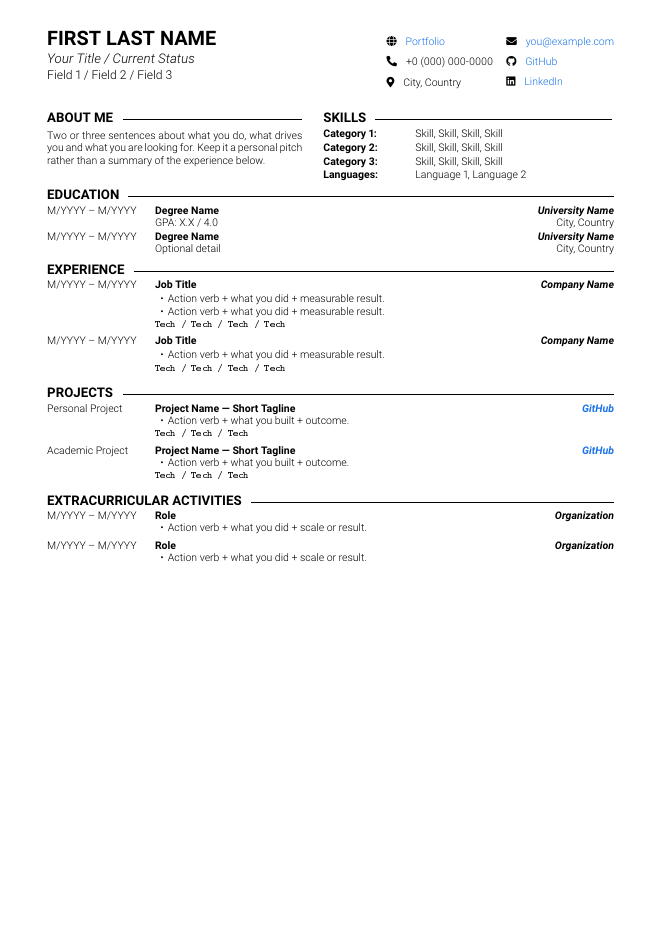
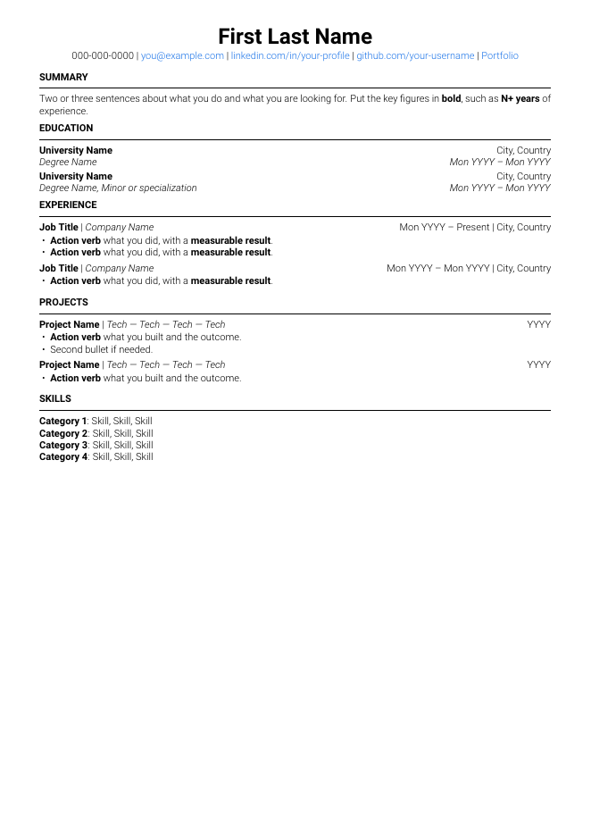

# LaTeX CV

The one-page CV I use for internship applications, written in LaTeX. The repository holds two templates, `classic` and `ats`. Fork it, pick one, and replace the content with your own.

[Version française plus bas](#cv-latex-en-français)

## Templates

| Template | Layout |
| --- | --- |
| `classic/` | Icon header, two-column summary and skills, dense grid with a date column |
| `ats/` | Centered header, single column, ruled section headings, bold key metrics, plain text that applicant tracking systems parse well |

| `classic/` | `ats/` |
| --- | --- |
|  |  |

Each template has the same shape:

```
<template>/
├── main.tex, main.pdf                     blank template with placeholders, start here
├── preview.png                            screenshot of the blank template
└── my-cv/
    ├── Marsel_Bakashov_CV_EN.tex / .pdf   my English CV
    └── Marsel_Bakashov_CV_FR.tex / .pdf   my French CV
```

`temp/` is a local scratch folder, ignored by git.

## Build

You need a LaTeX distribution with the `roboto` package (and `fontawesome5` for `classic`). MiKTeX and TeX Live both have them.

```bash
# blank template
cd classic          # or: cd ats
pdflatex main.tex

# my CVs
cd classic/my-cv    # or: cd ats/my-cv
pdflatex Marsel_Bakashov_CV_EN.tex
```

You can also upload a folder to [Overleaf](https://www.overleaf.com) and compile the `.tex` file there.

## Reuse

1. Fork or clone the repository.
2. Copy `classic/main.tex` or `ats/main.tex` and replace the placeholders: name, contact details, and the Summary, Education, Experience, Projects and Skills content.
3. Remove any section you do not need.
4. Recompile and check that the result still fits on one page.

## License

MIT License.

---

# CV LaTeX en français

Le CV d'une page que j'utilise pour mes candidatures de stage, écrit en LaTeX. Le dépôt contient deux templates, `classic` et `ats`. Faites-en une copie, choisissez-en un et remplacez le contenu par le vôtre.

## Templates

| Template | Mise en page |
| --- | --- |
| `classic/` | En-tête avec icônes, résumé et compétences sur deux colonnes, grille dense avec colonne de dates |
| `ats/` | En-tête centré, une seule colonne, titres soulignés, chiffres clés en gras, texte brut bien lu par les systèmes de suivi des candidatures |

| `classic/` | `ats/` |
| --- | --- |
|  |  |

Chaque template a la même structure :

```
<template>/
├── main.tex, main.pdf                     template vide avec placeholders, point de départ
├── preview.png                            capture du template vide
└── my-cv/
    ├── Marsel_Bakashov_CV_EN.tex / .pdf   mon CV en anglais
    └── Marsel_Bakashov_CV_FR.tex / .pdf   mon CV en français
```

`temp/` est un dossier de travail local, ignoré par git.

## Compilation

Il faut une distribution LaTeX avec le paquet `roboto` (et `fontawesome5` pour `classic`). MiKTeX et TeX Live les incluent.

```bash
# template vide
cd classic          # ou : cd ats
pdflatex main.tex

# mes CV
cd classic/my-cv    # ou : cd ats/my-cv
pdflatex Marsel_Bakashov_CV_FR.tex
```

Un dossier peut aussi être importé dans [Overleaf](https://www.overleaf.com).

## Réutilisation

1. Copiez ou clonez le dépôt.
2. Copiez `classic/main.tex` ou `ats/main.tex` et remplacez les placeholders : nom, coordonnées, et contenu du résumé, de la formation, de l'expérience, des projets et des compétences.
3. Supprimez les sections inutiles.
4. Recompilez et vérifiez que le CV tient toujours sur une page.

## Licence

Licence MIT.
